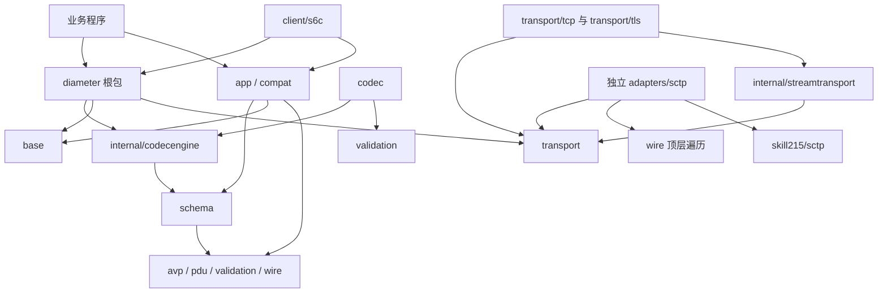

# 实施架构与代码结构

> 第87批：`client/s6c`、NewSRR/InterpretSRA已实现，见[实际接入契约](s6c-routing-helpers.md)。其余包树仍按支持矩阵区分目标与实现。

> 第68批更新：Relay-only协商和有限逐请求目标表已实现并验收，见[batch68](../spec/history/batch-68.json)。后文第67批扫描缺口为当时状态；目标表之外的动态发现和其他Ro/P4/发布缺口未由本批关闭。

> 第67批当前状态：独立adapter已锁定正式SCTP v0.8.0（bce1b3cf3ea3），源码与第66批候选一致，A–E、资源和Peer边界不变；正式版本回归完成，见[batch67](../spec/history/batch-67.json)。上游发布门已关闭，核心/adapter公开发布及现场验收仍单列；下文旧候选/未合并表述按历史时点阅读。

日期：2026-11-06。状态：Draft 0.21架构基线；以下摘要保留前二十三批架构基线（当前已完成前七十批，增量记录见文末及spec进度）：P1/P2 Base/S6c及公共包络/关联，P3 SingleAttempt预算/完成/pending/Peer、本地Shutdown与双连接选举切片，并接入TCP/TLS生产适配、有限Inbound/应答、有限Reject/应急预算、Canonical/有限缓存及多Arrival重答、固定同终端Route/多attempt与原身份重传、有限Dialer/Maintain拨号重连、两层按class/字节DRR、有限Listener/Serve、有界标识源/Session/guard及真实连接验收，实际支持/测试见[spec进度](../spec/progress.json)及[实施边界](../spec/README.md)。本文固定代码组织和依赖约束，协议/状态语义仍分别以[Specification](diameterkit-specification.md)、[运行时契约](diameterkit-runtime-contracts.md)和[Peer契约](diameterkit-state-consistency.md)为准。首版含Sh、S6c、SGd/Gdd、Ro及既定兼容/RO-06；Go1.26、纯Go、CGO=0、无持久化不变。

## 1. 架构选择与结束边界

采用**一个核心module、一个独立SCTP适配module、单一端点运行时、生成的协议实现**。核心module包含四应用、兼容定义、离线工具和TCP/TLS；根包diameter直接拥有Node/Peer/exchange/Arrival状态，低层协议包不依赖它。不同业务通过固定Profile/Binding和资源分区组合能力，不创建每应用一套网络栈。

| 选择 | 理由与限制 |
| --- | --- |
| 核心和应用同module | 模型、生成器和规则一起演进，避免四应用重复版本矩阵；导入某应用才建立其包依赖，不因module含Ro就启用Ro |
| SCTP单独module | 隔离Linux/上游依赖及真实内核验收；只接公共transport契约，不复制root内部账本/Peer |
| 根包拥有运行时状态，按文件分职责 | 不建立Node外观→internal/runtime→另一套Node/Result模型的双层包装；密切协作的状态提交留同包，小型无业务辅助机制才下沉internal |
| 生成类型/操作表，构造期显式组合 | 不在热路径反射、加载JSON/XML、遍历通用AVP树或动态切Profile；扩展是受检查的编译期Go代码，不是插件引擎 |
| 一个codec执行实现 | 离线复制输入和网络owned帧转交复用internal/codecengine，避免两个decoder产生语义差异 |

不增DDD聚合/仓储层、服务定位器、通用事件总线、存储接口、按应用拆module或goroutine-per-request架构。数据布局、锁粒度及默认容量可以由测量调整，不能改变单账本、一次完成、owned和有界取消语义。以下结构是实施起点，不要求先建所有空包；只有实现或目标证据指出具体矛盾才定点修订，不再安排全规范/全架构前置轮次。

## 2. 仓库与module布局

本地origin已指向`github.com/skill215/diameterkit`，实施采用该module路径，根包仍名`diameter`；消费者可显式用diameter作为import别名。SCTP module为`github.com/skill215/diameterkit/adapters/sctp`，包名sctp。路径是当前仓库的设计选择，不是已发布版本声明。

```text
diameterkit/
  go.mod, go.sum                     核心module，go 1.26.0
  doc.go, config.go, node.go          package diameter，配置冻结与生命周期
  peer.go, peer_state.go, watchdog.go 邻接、选举、连接代与控制门
  maintain.go                       唯一主动连接管理、退避/抑制与重连
  route.go, exchange.go, attempt.go   admission/选择/BeginWrite/Complete
  inbound.go, duplicate.go           逻辑工作、Arrival及Canonical缓存
  completion.go, result.go           唯一完成端口与发送证据
  identifiers.go                     分区发号、Session、固定guard表和HBH排空
  serve.go                           固定Peer监听接纳、两阶段握手及Wait屏障
  scheduler.go                       两层字节DRR、冻结权重、候选固定状态
  reader.go, writer.go, shutdown.go  连接I/O驱动、调度及关闭屏障
  identifiers.go, ro_recovery.go     号域/guard及RO-06受检接纳
  avp/                               基础值、Key、Optional、Raw
  pdu/                               头、Body标识、Message、envelope值
  wire/                              有界字节读写原语，供生成代码使用
  validation/                        Context别名、Report、Rule/Path等值
  schema/                            不可变Profile/Bundle及已编译操作契约
  codec/                             公开离线codec与frame便利API
  base/                              基础控制消息与固定定义
  creditcontrol/                     通用DCCA类型、所选命令/规则
  tgpp/                              已用的公共3GPP值/Grouped
  app/
    sh/                              Sh生成代码、Profile、纯helper
      shdata/                        所选XML子集，独立显式调用
    s6c/                             S6c生成代码、构造与解释
    sgd/                             SGd/Gdd生成代码及接口规则
    ro/                              Ro生成代码、构造/解释及纯恢复规则
  client/s6c/                        已有用法要求的薄Route便利层
  compat/
    sgdalert/                        旧SGd App下ALR独立命令/Profile
    smsfwro/                         六模板所需兼容、legacy420独立类型
    scap1/                           已审定App0/271域及恢复规则
  transport/                         公共Conn/Dialer/Listener/结果契约
    tcp/                             TCP适配
    tls/                             TLS/TCP适配
  internal/
    codecengine/                     唯一编解码调度/owned帧入口
    contextvalue/                    两类具名Context的封闭值与内部构造
    budget/                          reservation/split/transfer机制
    streamtransport/                 TCP/TLS共用有限帧cursor/deadline/取消管理
    codegen/                         严格JSON→IR→Go输出；只供工具
    testkit/                         有界fake transport、时钟/竞态barrier
  cmd/diameter-schema/                检查、生成、定义差异工具
  spec/                              严格JSON定义、依赖锁、规则来源
  testdata/                          脱敏fixtures、预期、来源、fuzz corpus
  interop/                           独立栈执行环境与证据说明
  examples/                          离线与TCP/TLS四应用调用示例
  adapters/sctp/
    go.mod, go.sum                   独立module，只此处require skill215/sctp
    config.go, conn.go, listener.go  公共transport的有限实现
    conn_linux.go, unsupported.go    平台分离；不支持明确报错
    examples/                        SCTP示例，不让核心反向导入适配module
  doc/                               当前设计/specification/审计，沿用真实目录
```

上述文件名用于分工，不代表一个文件只能容纳一个类型。普通测试邻近实现；公开消费者跨包验收使用外部`*_test`包，需检查内部预算/状态屏障的root集成测试可使用同包测试，SCTP测试在其module内。`spec/`是生成输入，`doc/diameterkit-specification.md`是库行为规范，不维护第二份相同规范；不新建误写的`docs/`。生成输出放实际所属包的`zz_generated_*.go`，纯helper/人工规则放普通文件，禁止手改生成文件。compat只按已承诺解释域设包，不先建后置S6a空壳。

开发可使用未提交的go.work连接核心、adapter及本地sctp；发布必须各module用GOWORK=off和固定require验证，不能依赖本地replace。先产生可安装核心候选，再锁adapter的核心及上游候选；嵌套module标签采用`adapters/sctp/vX.Y.Z`。核心require和普通examples不得反向引用adapter；独立集成从adapter侧导入核心完成，避免module依赖环。根`go test ./...`不覆盖独立module，CGO=0/race/真实association按原门槛分别执行。

## 3. 包依赖与数据类型归属

本页箭头统一表示“左侧import右侧”，替代旧设计中反向箭头的写法。下图只示主边，允许边及禁区以下表为准。



| 包/层 | 允许依赖及必须保持的边界 |
| --- | --- |
| avp、pdu、wire | avp依赖标准库；pdu可依赖avp，wire可依赖avp/pdu。都不依赖schema/codec/base/app/diameter。wire只处理长度、边界、padding、原始cursor，不认识应用规则、预算token或连接 |
| internal/contextvalue、validation | contextvalue只依赖中立值；validation可依赖avp/contextvalue。不得依赖schema/app/root；具名输入不携带Role/RequestEvidence的可写冒充入口 |
| schema | 可依赖avp/pdu/wire/validation；不依赖codec/engine、具体base/app/compat或根包。拥有Profile组合及操作契约，构造期复制元数据并检验完整性 |
| base、creditcontrol、tgpp、app、compat | 依赖上述中立层和明确的下层共享类型；app可依赖base的公共组/独立E编译操作，base不回指app；可使用wire但不得导入公开codec、codecengine或root。creditcontrol/tgpp不回指app；SGd/S6c不互相导入；compat可依赖兼容字段的标准公共类型，标准包不依赖compat |
| internal/codecengine、codec | engine依赖schema和中立层，不导入具体应用、root或transport；公开codec包装engine，不反向供engine导入。两入口使用同一限制校验、生成操作和错误分类 |
| diameter | 可依赖schema/codecengine/validation/base/transport/budget，不直接依赖app、compat、client、SCTP或codegen；通过已选Bundle的操作表处理应用数据 |
| transport及各适配器 | 公共transport只依赖标准库及必要中立值，不依赖root/账本/生成器。tcp/tls/sctp依赖transport而非相互实现；同module的tcp/tls仅额外共享internal/streamtransport，该包只依赖transport/标准库。适配器不得访问codecengine、budget、contextvalue或root内部状态；独立SCTP模块不得依赖核心internal；第72批为Session选流显式允许依赖公共wire的顶层遍历，不引入codec或应用语义 |
| client/s6c、examples | 作为组合入口可导入diameter与应用包；client只做参数/结果转换，不另建完成通道、定时器或恢复引擎。不为对称目录预建四套client |
| cmd/internal/codegen、testkit | 工具IR只被工具导入；testkit只被测试导入。正式代码不得通过这些包绕开依赖边界 |

pdu.ErrorAnswer及envelope所需的低层值放pdu/avp，不让pdu导入base。基础控制语法的生成实现仍归base。请求/应答的Origin、Session及代理链补齐需要实际body类型和Profile，因而旧`pdu.CompleteRequest`方案撤回：离线改为`(*codec.Codec).CompleteRequest(body, envelope)`，runtime走同一engine操作；pdu只承载值和命令身份。签名拼写可微调，补齐不能下沉成叶包对应用的反向依赖。

`app/ro.CCR`与通用`creditcontrol.CCR`不强行type alias：Ro使用自己的强类型消息，复用公共AVP/Grouped，在App4的固定Profile中选择唯一命令实现。legacy420在冲突父路径使用compat自己的Grouped类型，不能改标准CC-Time或用any覆盖。SCAP1即使App0也不进入CER/DWR/DPR固定控制分派。共享定义按语义/线路身份复用，出现位置规则仍由各Profile生成。

## 4. 生成代码与codec如何连接

生成器输入仍只有严格JSON定义和显式绑定的人工规则符号；文件→已验证IR→确定性Go输出/来源索引。生成器自身不能导入全部生成应用来“发现”schema，否则bootstrap形成环。人工复杂规则提供明确符号、RuleID、适用路径和测试引用，生成代码直接调用；不运行任意表达式解释器，不从规则字符串反射查函数。runtime不读spec文件，也不需要旧XML、模板binary或联网规范。

schema持有已编译操作的有限契约，应用Profile工厂把本包生成函数显式装入：命令识别/具体body类型检查、计量与clone/envelope处理、encode/decode、各阶段校验、关联/Canonical和已审核恢复规则。接口参数只使用中立层类型、limits与有界值，不引用codec.Config、diameter.Result或核心reservation。Compile核验必需操作、规则/版本指纹及上界齐全后冻结；没有操作的能力不能仅凭描述符宣布支持。函数指针地址不进入可复现WireFingerprint，行为版本/来源进入定义锁。

生成代码按已选父路径和Vendor/Code直接分派，函数入口用具体类型断言拒绝错误body，不用reflect.TypeOf注册。wire是为仓库外生成扩展必须公开的窄字节原语包；其输入借用仅在同步调用内有效，不是新DecodeView或整消息租约API。用户生成包只需公共wire/schema/pdu/avp/validation；使用公共组/E工厂时可依赖base，不能依赖本仓库internal。完整扩展集合将通过规划的schema.ExtensionSet受检构造（尚未实施）；完整生成IR仍私有，不增加一个公开schema DSL。外部扩展必须同样提供限制/所有权契约，不能绕过固定Profile或预算。

第二批建立的操作表为Decode/Encode/Validate/Clone/CompleteRequest/DecodeBound/Envelope/CompleteAnswer，答案可另声明完整ErrorOperations；操作表复制冻结。公共E编译工厂归base，engine只消费已选操作，不导入base/app。关联使用内部不可变RequestSnapshot和有限AnswerSources，未新增公共Correlation框架；RequestSnapshot本身不持有pending/timer或完成权，第三批由root持有这些运行时权利。Measure、快照及预留估计已提供；第八批增加当前子集Canonical，第九批增加有限TransportReplay许可及活动SRR恢复；有限Sh具名Context/报告已在第二十批落地，完整范围和Ro/RO-06恢复操作仍待相应阶段。详见[第二批契约](../spec/history/batch-02.json)。第三批ops3增加目的字段提取，root逐命令固定绑定在准入前/完成包络后受检。

pdu.Body的最小命令标识方法须可由外部生成包实现，不用包私有marker把扩展封死；具体Go类型与所选命令是否相容由Profile操作核验，不相信调用方只报一个CommandKey。这个扩展点与封闭的validation.Context不同，不能为了统一风格把两者都做成任意接口或都禁止外部实现。

公开codec.Decode先取得有界owned副本，再交engine；codec.Read可将自己新取得的帧交engine。网络reader先按reservation取得dst，完整后调用internal/codecengine的owned入口，成功转移数据所有权、失败结清引用；engine只接收帧/limits，不认识账本token，额度转移由root负责。root与codec各自把配置映射到engine同一校验后的设置，不能复制两套限制算法。共享backing的所有权按运行时契约计费，不增加公共Release或把内部零拷贝入口导出。

validation.Context的“外部不可任意构造”和“应用工厂可生成”需要真实Go可见性方案：public Context采用internal/contextvalue封闭Value的类型别名，字段不导出；同仓库sh/ro的具名工厂调用内部有限构造函数。Value不依赖app/schema/validation，避免环；对外始终以validation.Context出现，其方法集与别名身份按公开兼容性维护。外部生成扩展可以消费既有Context，不获得任意新fact注册权限。首版仅Sh PeerFeatures、Ro SessionFeatures；FieldSelection是ro构造参数。无反射写私有字段、unsafe桥或init注册。

## 5. 运行时、传输和Ro恢复的归属

| 状态/动作 | 唯一所有者与组织 |
| --- | --- |
| 配置/Bundle/能力选择 | config.go构造期校验并冻结；Node只接收显式Profile集合，基础控制固定表与应用广告分开 |
| Peer/连接代/watchdog | peer_state.go/watchdog.go；候选、Ready、发送门、原因与timer代数在原状态提交门处理 |
| exchange/attempt/Completion | exchange.go/attempt.go/completion.go；同步Request和Submit共用一套admission/BeginWrite/Complete，不复制同步引擎 |
| Inbound/Arrival/重复结果 | inbound.go/duplicate.go；缓存与每连接应答发送权分开，Canonical使用生成规则；不建订阅/计费Session仓库 |
| 预算 | root决定Q/A/I/W/C/M所属和转移，internal/budget只提供计数/原子预留机制，不导入root类型、不暗中调度I/O |
| reader/writer | 每连接一个reader和一个writer；没有每请求goroutine/独立读者。writer在帧边界调度，reader驱动prefix→申请→frame/event/discard，适配器不见token |
| timer/关闭 | timer数量随受限Peer/连接/活exchange有界，不能每次重传新增永不回收的timer；Close/Wait、原因和借用退出遵循原契约，不另建actor总线 |
| RO-06 | 根包ro_recovery.go提供Node关联的PrepareRoRecoveryRequest/SubmitRoRecovery概念入口与记录、guard/接纳；app/ro和compat提供纯协议提取/规则，由已冻结Profile有限操作连接，root不type-switch ro.CCR |

RO-06的Prepare需要Node号域，不能放进纯app/ro伪装成无状态helper；app/ro.PrepareSMSDebit仍是纯构造。Recovery操作只接受已审核Ro/SCAP1命令/触发/固定目标策略，不成为任意命令可挂载的恢复插件。记录拥有原线上字段与有限元信息，不持有Node指针、fd、callback或pending；存取记录与发送意图仍由应用负责，库不选文件/数据库格式执行保存。

根包按Node→Peer→exchange/Inbound→额度的既有锁序实施；状态提交锁内不做I/O、用户hook或编解码。不以“分层”增加跨包往返callback。内部辅助包只在已有独立职责和可验证输入输出时抽取；无需先为每个状态机建interface。测试可注入有限时钟/ID/transport故障点，生产不公开通用调度器插件。

transport公开结果保持协议中立：固定帧头快照、长度/进度、元信息、TransportEvent与终止原因；不返回schema.Bundle、Peer或业务Result。上游ReadEvent属于sctp包，本库TransportEvent属于transport，适配器完成固定映射，不能混用两个ReadResult。构造期资源需求通过transport的工厂/配置契约声明，实例Info只核验；已存在的外部conn在交给Node前须匹配预先声明的固定上界，非nil conn在Connect/Accept调用时移交唯一所有权，成功由Node持有、失败由Node幂等Close；调用方不得继续I/O或把同一conn交给第二个Node。接管前检查并取得额度，不能绕过Node预算。Node只约束接管后的资源，不能追溯限制调用方在接管前的任意分配。

SCTP按[上游契约](diameterkit-sctp-upstream-contract.md)和[运行时§3.5](diameterkit-runtime-contracts.md)实施；Tw独立、S=0、事件续调、旧代槽和SEND_FAILED证据规则不变。TLS握手由tls适配器在受控ctx内完成，证书认证由应用显式TLS配置决定；Diameter Origin/共同应用由Node检查，证书与Origin的部署映射由应用显式检查；类型/limits契约不得要求所有传输都暴露syscall.RawConn。core模块不导入SCTP、不加载内核模块，纯Go不等于跨平台SCTP。

## 6. 实施顺序与有界架构验收

| 顺序 / 原阶段 | 阶段产物 | 结束标准 |
| --- | --- | --- |
| 1，P1 | 核心module、avp/pdu/wire/validation/schema最小类型，生成操作契约和包依赖检查 | Go1.26/CGO=0可编译；叶包无反向导入；一个外部最小扩展按操作契约可编译，不能依赖内部路径；外部完整生成切片已在第一/二批验收 |
| 2，P2 | 严格JSON生成器、base及一组S6c SRR/SRA的纵向切片，engine和公开codec | 所选成对固定样本的独立解读及定向反例、Presence/Vendor/父路径、owned复制/转交、错误和上界一致；重新生成无差异。只用该切片验证机制，不据此缩小四应用承诺 |
| 2续，P2（第二批已完成） | 公共正常/E包络、关联、内部owned请求快照和保守预留估计 | 正常/E成对报文与来源/代理/诊断反例、外部生成接入、复制/并发/溢出回归；尚无pending/账本/Peer |
| 3，P2/P3（第三至十九批完成出站/关闭/选举、TCP/TLS及有限Inbound/Reject/重复缓存/Route/连接管理） | root预算/完成/每连接pending/Peer、本地关闭与双候选选举已落地；TCP/TLS及有限Inbound已在第五/六批验收；有限Reject/应急预算在第七批完成，第八批完成有限Canonical/重复缓存与多Arrival，第九批完成固定同终端Route/多attempt，第十批完成有限Dialer/Maintain，第十一批完成两层按class/字节DRR，第十二批完成固定Peer的有限Listener/Serve，第十三批完成有界标识分配/Session/guard，第十四批完成Base/S6c有限Context/Report，第十五批增加普通RDR/RDA与HSS ALR/ALA，第十六批增加SGd/Gdd普通MO/MT及编译后的答案关系，第十七批增加Sh普通四组命令与透明User-Data，第十八批提供显式Ref24/25 XML helper，第十九批增加单订阅/退订及Ref11/12数据；完整诊断、多Peer admission及四应用定义继续 | 基础握手→请求/应答→取消/关闭可执行；超限、完成消费者停滞和旧代竞态按原PEER/BUD验收；绑定不相容Profile失败 |
| 并行，U1–U5 | skill215/sctp回归和U2/U3/U4补齐，同候选通过后锁依赖 | 上游有限验收通过；不等本库DRA/OCS，不以本地replace作为候选发布证据 |
| 4，P3/P4/P5 | SCTP真实接入、四应用helper/流程、compat/RO-06与示例 | 上游通过后才启用真实SCTP；四应用/六模板/恢复各按既有清单，未知字段及目标许可只阻塞对应分支 |
| 5，P6/P7 | 独立互通、逐module发布构建、fuzz/race/资源/性能与外部消费者验证 | 满足原首版门槛；不以生成成功或单栈round-trip替代独立证据 |

第三批使用root单一短提交锁串行化接纳、BeginWrite、Complete和账本修改，编解码/I/O在锁外；每连接reader/writer、Node一个有界deadline扫描timer。`internal/budget`只提供reservation机制；fake只在`internal/testkit`，正式root/应用不导入它。`transport.Conn`当前仅data-frame两阶段契约，SCTP通知续调未实现，不能以此绕开U2–U4。Node拥有完成端口及其ring预算；实际签名与未实现项见[第三批契约](../spec/history/batch-03.json)和[第四批增量](../spec/history/batch-04.json)。第四批沿用同一状态提交门，handshake.go管理最多两个候选及选举，shutdown.go管理Draining和共享总截止；物理槽在握手/I/O借用退出后退休，构造期固定预留覆盖两个候选。选举中的被动前缀读取获选后直接交给reader，不新开并发socket reader；公共Shutdown调用等待timer有界，Node仍共用一个状态扫描timer。

第五批在transport/tcp、transport/tls下实现已建立socket的适配，internal/streamtransport共享分阶段帧读取与方向deadline管理，不依赖root/schema/账本。TLS握手发生在Node接管前，由调用方控制接入并发；固定4096字节适配预留排除标准库TLS和内核缓冲，不是RSS上限。实际API/限制见[第五批契约](../spec/history/batch-05.json)。

第六批由root/inbound.go拥有接纳、私有请求凭据、单次Respond和原Arrival的发送权；复用现有reader/writer及Node状态门，不在适配器或应用包增加调度引擎。InboundClasses是独立硬分区，NoCache显式选择单Arrival模式；该批writer在有业务请求/应答时逐帧交替，已由第十一批两层按class/字节DRR替代。实际预算/生命周期见[第六批契约](../spec/history/batch-06.json)。

第七批由root/reject.go负责固定FailurePolicy、可信包络扫描和有限错误构造，复用inbound.go的一次提交与借用生命周期，不在传输层增加协议策略。应急槽在TransportReserve内固定预留，以独立rejectAccount记录活动用量，避免重复扣Node动态额度；已接纳请求的超时帧在交付前由I/W预留完成，timer只竞争状态和排队。其配置、代码分工及限制见[第七批契约](../spec/history/batch-07.json)。

第八批由生成器生成请求Canonical字段规则，wire负责有界原始比较序列，codecengine/codec负责先验证再调用；root不导入应用包。duplicate.go拥有Node范围的Origin/E2E索引、固定期限和独立C账本，inbound.go继续持有逻辑提交权及每Arrival发送借用。缓存模板剥离首份Proxy/头，在writer锁外组装并校验本次包络，实际I/O前复查关闭门；不启动缓存worker或每请求goroutine。当前为保守完整Arrival I/W预留，最小拆分转移仍待优化验收；见[第八批契约](../spec/history/batch-08.json)。

架构检查并入既有GEN-01、OWN-01、BOUNDARY-01、PEER/BUD/SCTP和SPEC-01：①import DAG/禁区；②仓库外生成扩展编译；③单一codec语义与owned边界；④显式注册/compat隔离；⑤两module GOWORK=off固定依赖；⑥无持久化/无cgo、状态与资源一次归还。保持24个SPEC ID，不新增一套架构认证或全矩阵。

构造性检查已随前二十三批代码建立：核心CGO=0编译、import DAG、外部生成消费者、owned及生成一致性进入自动测试；其余阶段按上表继续。API拼写、包内文件拆分和容量默认可在相应阶段的编译/负载测量中微调；禁止为这些细节重新暂停已明确任务。剩余协议/目标证据沿[Specification §7.1](diameterkit-specification.md)，不是“先补完所有定义才写codec”。设计基线及specification应随实现纳入版本管理；当前未提交/被本地ignore的审计文档不能当作消费者已获得的发布契约，发布前整理可公开的来源与脱敏证据，正常构建不依赖邻仓文件。

## 7. 参考与取舍来源

[Go module组织指南](https://go.dev/doc/modules/layout)支持公共库、internal辅助和cmd工具分开组织；[Go模块参考](https://go.dev/ref/mod#workspaces)用于workspace/独立module验证；[Go import规则](https://go.dev/ref/spec#Import_declarations)与[internal可见性](https://pkg.go.dev/cmd/go#hdr-Internal_Directories)约束无环和外部扩展边界。两module、根包状态所有权及wire/schema划分是本项目针对已定需求的选择，不宣称是Go唯一推荐结构。

[OTP dictionary](https://www.erlang.org/doc/apps/diameter/diameter_dict.html)将应用编解码放在生成字典模块，服务显式选择；这里借鉴生成与服务解耦，不照搬Erlang进程或字典继承为Go插件。已有go-diameter反射/AVP树/Vendor索引痛点及sms-fw调用证据继续见[API审计§1](diameterkit-api-workflows.md)。

第九批由root的route.go持有逻辑group、有限attempt摘要及唯一恢复调度门；exchange.go复用接纳/不可变请求，reader/writer/timers仍为原有连接驱动。codecengine的ForAttempt只重绑头/来源，业务体只读共享。全部A在首次接纳时从Node/class/port一次预留，各Peer窗口单独约束；旧writer退出才能重写共享发送帧，全部I/O退出才能发布并缩减额度。连接退休后历史attempt只留摘要，不持有transport。没有独立recovery engine或每请求goroutine，详见[第九批契约](../spec/history/batch-09.json)。

第十批的maintain.go管理固定Peer域的拨号与有限退避，仍不接管业务exchange；handshake.go拆分接纳/握手/安装门，主动拨号先占原有候选槽，空transport候选也被Close/Shutdown/Wait覆盖。TCP/TLS Dialer只负责一次固定地址建立，shared streamtransport提供标准库拨号辅助；依赖方向不变。每Peer固定4096字节管理预留，一个调用方运行的Maintain循环及复用等待timer；取消回调只撤销连接域，Shutdown保留排空所有权。真实重连须通过REOPEN，并由应用决定是否显式重传，详见[第十批契约](../spec/history/batch-10.json)。

第十一批由root/scheduler.go持有冻结计划、每连接两层DRR和有界cost scratch，writer.go负责帧准备、调度提交与实际I/O；入队/取消/关闭走同一组计数清理入口。状态门内只读已编码帧大小和维护credit，Control编码在门外；复用现有队列，不另建调度插件、后台引擎或每请求任务。预算与证据范围见[第十一批契约](../spec/history/batch-11.json)。

第十二批由root/serve.go拥有每Peer唯一监听管理者，并在调用Listener.Accept之前占原被动候选。transport.Listener/Incoming将socket接受与TLS Establish分开，root决定共同绝对deadline和安装门；TCP/TLS包装预绑定listener，shared streamtransport串行回收Accept取消回调。没有新增接入引擎或按连接累积的历史队列；Serve取消只撤销未安装候选，已建立连接仍由原Peer生命周期管理，详见[第十二批契约](../spec/history/batch-12.json)。

第十三批由root/identifiers.go持有固定发号状态/guard表及额度，exchange/Route只持一个逻辑ID lease，控制job持有限独立lease；退休点复用原writer/reader/一次完成门。自定义源在预算接纳之后、Node锁外串行执行，源忙失败而不加后台队列。HBH耗尽复用原timer/Closing/DPR路径，不另建重连引擎；精确契约见[第十三批](../spec/history/batch-13.json)。

第十四批在schema.Command/生成定义增加NoContext审核位并纳入ops6指纹，codec公开报告只新增对中立validation类型的依赖；codecengine统一实现阶段检查，root保留私有Inbound报告及Result报告。未增加app反向依赖、通用facts provider或消息会话表；明确范围见[第十四批](../spec/history/batch-14.json)。

第十五批通过现有S6c生成定义/规则增加RDR/RDA、ALR/ALA，Time为avp中具名线路值；codecengine区分已收到原请求的关联与本端发送验证。没有新增运行时应用分支或MWD/提醒状态机；独立运行/离线证据见[第十五批](../spec/history/batch-15.json)。

第十六批增加独立app/sgd包，和app/s6c一样只依赖中立层、schema与base；不相互import。ops7的CheckAnswer使codecengine在原请求/正常答案之间调用受信任静态关系，E显式隔离；root没有应用特判、新队列或状态机。范围与验收见[第十六批](../spec/history/batch-16.json)。

第十七批增加app/sh，沿既有VSAI/Time/OctetString生成操作，未修改ops7或增加运行时应用分支。该批Sh-Data只保留原字节；有限XML helper独立于wire与业务状态，实施边界见[第十七批](../spec/history/batch-17.json)。

第十八批落实独立app/sh/shdata，仅依赖标准库与avp。encoding/xml仅在此包使用token入口；核心及app/sh均不import该helper，调用者显式解析/构造。没有通用DOM、schema加载或反射Unmarshal，单次Limits与应用工作预算边界见[第十八批](../spec/history/batch-18.json)。

第十九批仅扩展Sh定义/规则与shdata有限叶，生成器和runtime没有新层次；710进入生成的测长、拥有值、Canonical与版本指纹，不建立订阅表或新调度器，见[batch-19](../spec/history/batch-19.json)。


第二十批落实既定封闭Context的Go可见性：app/sh工厂→internal/contextvalue（不依赖app/schema/validation），codecengine消费固定CheckContext，root不import Sh。具名Context是有界拥有值，最多两个终端、各4个支持bitmap；没有provider接口或长寿命协商表。入站Check复用Respond的preparer及Wait借用屏障，状态门外执行规则，成功冻结、失败不覆盖；出站RequestSnapshot冻结验证后的证据。生成器9/ops8新增显式M位捕获与Canonical例外，SNR切片API变化及逻辑预算见[batch-20](../spec/history/batch-20.json)。

第二十一批只扩展app/s6c定义和纯规则：两个独立node父类型、国际十进制SMEA helper及既有CheckAnswer配对。root、codecengine、Context和队列层次未变；较大结构的DecodeBound沿原预算收费，应用保有Gdd/VLR事实职责。开发期Optional变更、证据及范围见[batch-21](../spec/history/batch-21.json)。

第二十二批在app/s6c生成定义加入MSC/SGSN两个独立报告父组，局部cause/诊断纯函数接收父组固定允许集合；不合并父实例，不改变root或codecengine的依赖与生命周期。RDA/MWD职责、3584字节结构估计和旧库有损诊断差异见[batch-22](../spec/history/batch-22.json)。

第二十三批app/s6c沿用app/sh的封闭contextvalue工厂路径，增加固定Alert角色/端终端值和kind，复用原中立Endpoints及CheckContext；DAG测试显式允许s6c→contextvalue，root不依赖应用。两种Context隔离、ALR身份API变化和旧HSS零Context边界见[batch-23](../spec/history/batch-23.json)。未增加角色服务、历史库或调度器。

第二十四批app/sgd增加封闭Retransmission Context与kind3，DAG只增加sgd→contextvalue；四段有界端终端字符串及固定标量复用既有bookkeeping，无新队列、定时器或状态存储。公开codec.ValidateResponseContext转接已存在的发送校验，避免离线使用接收规则误放行时间相等；runtime行为沿原Check/Respond冻结和借用屏障。SGd slice.9的字段、era与范围见[batch-24](../spec/history/batch-24.json)。

第二十五批app/sgd增加T4Charging固定身份/SC/端点Context及kind4，复用现有Endpoints、Check冻结与预算；不增加root→app依赖、查询服务或T4 Session管理。OFA3111/M0、有限ASCII和未知映射接收报告见[batch-25](../spec/history/batch-25.json)。TCP/TLS只验中立运行机制，T4 SCTP部署门槛仍待上游/适配器落地。

第二十六批app/s6c增加T4NoMSISDN固定用途/IMSI/SC/端点Context及中立kind5；使用现有Endpoints/Check冻结与bookkeeping，不增加root→app依赖、MWD/业务历史或消息编排。RDR改用独立ReportUserIdentifier（Optional IMSI/MSISDN互斥），SRA/RDA旧类型不变；Context表示加最大活动证据字符串由测试核对≤2KiB。HSS无Event的IMSI ALR静态解码后须有T4证据，MME/SGSN角色仍要求Event。详见[batch-26](../spec/history/batch-26.json)。

第二十七批复用kind5承载T4Routing，无新Context字段或预算类。SRR顶层Optional UserName/MSISDN互斥；SRA CheckAnswer核对原IMSI，CheckContext绑定用途/端点/SC，原Additional节点条件保留。固定同HSS的SRR TransportReplay对IMSI分支已通过双attempt/晚答测试，不引入业务重试。API迁移及有界验收见[batch-27](../spec/history/batch-27.json)。

第二十八批增加S6c RoutingRole(kind6)的固定终端角色/UNRI证据；UNRI是外部事实，不占SRR-Flags位、不引入状态库或回调。沿Endpoints/Check冻结，Context表示与最大活动字符串仍由既有≤2KiB测试验证。SRA已知诊断的Receive保留与Send/完整Report未支持边界独立，未知事实或保留诊断仍只完成一次。见[batch-28](../spec/history/batch-28.json)。

第二十九批MOForwarding(kind7)显式区分共用应用ID的SGd/Gdd，复用kind4固定身份存储，不扩大Context≤2KiB或128KiB账本预留，不加运行时分支/队列。静态原MSISDN关联与应用接口证据分层，端点/私有请求/冻结仍沿公共引擎。接收语义未支持报告不引起重试，见[batch-29](../spec/history/batch-29.json)。

第三十批只扩大S6c生成字段及应用规则：ServingNode/AdditionalServingNode有独立IP-SM-GW父路径选择，Receive保留与Send/完整报告分层，ALR显式隔离。无新Context、队列或回调；新叶进入生成计量/上界，现有答案预算及多attempt一次完成不变。SRA节点字段不自动写入Peer配置，见[batch-30](../spec/history/batch-30.json)。

第三十一批仅扩大S6c结果父组与应用规则：普通MSISDN RDR增加IP-SM-GW typed outcome，沿生成Measure/DecodeBound、Canonical、已有I/W/C预算及一次完成；无新Context或核心状态。离线可保留的未支持值不自动成为运行时可接纳请求，既有readInbound语义Rejected仍关闭连接。MWD/SC历史与投递调度继续属于应用，见[batch-31](../spec/history/batch-31.json)。

第三十二批增加RDR专用SMSMI组和IMSDeliveryReport封闭证据kind8，内部T4/IMS身份存储复用但用途getter互斥。协议中立运行时继续只读Endpoints，证据和生成字段纳入原预算；新增及旧最大Context均≤2KiB。URI保存原字节，HSS-ID不用于动态发现，身份分配/MWD及投递历史仍属应用。实现和边界见[batch-32](../spec/history/batch-32.json)。

第三十三批增加ALR专用SMSMI组和IMSHSSAlert封闭kind9，复用S6c身份存储且不增加Context容量；用途与IMS报告/T4/普通AlertRole严格分开。中立运行时沿原Endpoints、I/W/C预算与完成门，ALR和RDR pending独立。Time仅存线路原值，提醒重试/MWD/SC转发属于应用，见[batch-33](../spec/history/batch-33.json)。

第三十四批增加SRR专用SMSMI及IMSRouting kind10，内部S6cIdentity的原对齐空间容纳Role/UNRI；Context容量和2KiB预算不增。端点绑定、原请求快照、两种固定同HSS恢复及每attempt答案预算沿用中立运行时，无新增状态机/队列/存储。HSS-ID与答案IMSI不是同一语义，不靠数字相等/不等证明分配，见[batch-34](../spec/history/batch-34.json)。

第三十五批新增内部`internal/smsidentity`保存S6c/SGd共享的有界HSS-ID/SIP词法与双URI摘要，不让应用包互相依赖。IMSMOForwarding kind11复用重命名的SMSIdentity，Context由672增至704字节，新旧证据仍≤2KiB；摘要只绑定用途证据，owned请求保留原URI，Canonical不改为摘要比较。生成OFR身份UserName为Optional，普通MO必需性移至命令规则。没有新运行时队列、持久化或OFR重放许可，见[batch-35](../spec/history/batch-35.json)。

第三十六批增加IMSMTForwarding kind12及独立MT两叶SMSMI，沿既有SGd上下文hook按SMSMI presence分派。复用SMSIdentity，Context仍704字节；双URI使用独立MT摘要域，MO域不改。没有新增队列、预算层或TFR TransportReplay许可，见[batch-36](../spec/history/batch-36.json)。

第三十七批在IMSMOForwarding kind11中增加可用源IMSI/真实MSISDN绑定，复用Value内其他kind才启用的源字段槽。用途仍由kind隔离，不共享T4授权；无新增Context种类/字段容量、队列或预算，amd64仍704字节，新分支保留量≤1776字节。缺省Optional残留Value不复制，见[batch-37](../spec/history/batch-37.json)。

第三十八批在S6c既有报告Context路径启用T4 IP-SM-GW结果；沿统一父组校验后检查T4DeliveryReport及IMSI/SC/端点。仅移除旧子集限制，不增加Context、结构容量、队列、预算或RDR重放，见[batch-38](../spec/history/batch-38.json)。

## 第三十九批架构增量：Ro IEC基础

[app/ro](../app/ro/rules.go)新增独立App4生成Profile，规则只做所选标准SMS字段/结果/原请求关联；root与codecengine不导入ro。没有新增信用控制持久化服务、应用会话管理、Context种类或调度队列。既有单attempt/Inbound/预算/完成路径直接消费编译操作。

[wire](../wire/wire.go)增加精确Unsigned64；generator10对u64生成typed字段、克隆、编解码及测量，ops8不变。Base/S6c/SGd/Sh生成输入不变，但所有生成摘要与Bundle指纹重新计算；应用应重新编译所选Profile，不能混用旧摘要证据。标准420继续是未选CC-Time，不与后续compat私有类型共用宽松字段。

本批只启用标准SMS IEC单服务；ECUR、六模板/私有绑定、SCAP1、RO-06及结果便利层仍沿原包规划。CCR暂不授予TransportReplay，TCP/TLS样本通过不代表OCS恢复或SCTP部署认证。详见[batch-39](../spec/history/batch-39.json)。

## 第四十批架构增量：ECUR与纯请求关联

Ro slice.2复用现有App4 CCR/CCA操作，增加USU/FINAL、顶层设备和有限PS类型；generator10/ops8、所有中立Context存储及预算不变，其他Profile生成输出不变。`app/ro.CheckECURContinuation`只比较调用方的两个完整请求body，不导入root/codecengine、不保留INITIAL、也不制造完成权或恢复身份。

跨请求helper不是runtime隐式步骤；Result.Validation仍仅报告当前exchange，应用校验初始CCA、计量用量并显式发送新TERM。无UPDATE序列1/0→3/1属于所选能力，未提供通用CC序号分配器。旧IEC中SMS-Node1的SMS-SC文字误称已更正为IP-SM-GW，未改线路值。详见[batch-40](../spec/history/batch-40.json)。

## 第四十一批架构增量：隔离的旧IEC模板

`compat/smsfwro`仅依赖公开中立层与Base，root和app/ro不依赖compat。静态生成器11增加i32；标准五定义未改，全部生成摘要刷新。独立Profile固定App4/272解释，在同Bundle与标准Ro冲突；调用方以独立Node和固定终端来源/目的部署，不以请求Action/长度切换字典。`NewIEC`只复制显式输入和模板常量，不读模板文件、不保存计费会话。无新Context、队列、恢复权限或资源类别。完整映射/证据/后续420边界见[batch-41](../spec/history/batch-41.json)。

## 第四十二批架构增量：固定420退款子包

`compat/smsfwro/legacy420`是独立静态Profile/Go类型，只依赖中立层和Base；本次不重构根包或标准Ro。金额路径固定Grouped420，i64/i32类型无浮点中间值，父路径和Action约束由该Profile验证。与IEC-only/标准Ro同Bundle冲突；将来组合须显式扩展单一固定定义，不能让runtime按Action切字典。`NewRefund`只复制调用方明确输入，无计费会话、token保存、新Context/队列/预算类或恢复许可。见[batch-42](../spec/history/batch-42.json)。

## 第四十三批架构增量：IEC/ECUR固定类型组合

smsfwro slice.2为同一App4/272固定字段类型增加ECUR分支；Type/Action仅选择出现条件，不选择decoder。RSU、Action、2008改Optional以表达实际缺项；状态/放行Time在同一SMS类型可选、由请求类型约束。无需新增profile包/Context/资源类，generator12/ops8不变。纯Continuation检查只比较应用传入的两个完成请求；runtime无计费会话。退款legacy420保持独立，未来组合须继续保持420唯一类型。TERM源顺序与固定sender的一个独立叶交换见[batch-43](../spec/history/batch-43.json)，不为顺序问题添加运行时模板DSL。

## 第四十四批架构增量：通用模板与答案值

legacy420 slice.2在现有包中固定定义413/420两个键，扩展扣费/余额及Cost/GSU；显式builder与原请求关联复用既有操作，不新增financial runtime。Client-Address在本域固定Address，另一旧IEC/ECUR域固定STRING；同App4/272不可重复Compile，未来五模板组合必须解决2018唯一解释，不能按动作选择解码器。Money和token改Optional的开发API迁移、缺省指数与零及错误分支边界见[batch44](../spec/history/batch-44.json)。

## 第四十五批架构增量：SCAP1离线域

`compat/scap1`落实既定App0/271独立命令位置，生成47源节点和11重复父实例；没有改变根runtime控制分派或能力归并。离线Bundle可以同时注册Base控制和ACR，Node仍拒绝App0业务策略。下一批须显式绑定头0/271与Vendor193/Acct19302，并让业务请求走应用预算/pending，不能简单删除App0拒绝条件；旧双Auth/Acct广告不应无条件放宽标准Base规则。详细有界出口及合成ACA证据边界见[batch45](../spec/history/batch-45.json)。

## 第四十六批架构增量：SCAP1显式会计绑定

根包[application_binding.go](../application_binding.go)提供有限枚举，不依赖compat包，也不建立通用动态应用映射注册器。CommandPolicy/InboundPolicy各自显式选择SCAP1Accounting，Node校验本地能力及固定出站目标；每代connection保存原应用集合和独立会计能力标记，握手、提交、Route及入站统一使用同一判定。普通非零头应用行为不变，SCAP1头0/271只在显式Peer策略下分到普通业务预算/pending；固定Base控制路径保持独立。

没有增加业务队列、Context类型、预算class或计费状态；重连丢弃旧能力，无自动重放。本批具名严格Vendor193/Acct19302条件不改变通用RFC应用号匹配规则，旧双Auth/Acct广告仍拒绝。真实TCP/TLS、预算和生命周期证据及未验现场范围见[batch46](../spec/history/batch-46.json)。

## 第四十七批架构增量：固定五模板wire组合

`compat/smsfwro/combined`拥有独立生成类型和唯一App4/272操作集，不将两个重复命令Profile强行Compile。2018固定为owned线路字节，模板规则只验证出现/常量/复制关系，不选择decoder。显式builder复用原smsfwro/legacy420输入和源构造器，经私有逐字段适配构造组合消息；这两条单向依赖纳入包DAG测试，父包不反向依赖combined。原Profile保持严格类型和摘要；无反射、全局注册、运行时模板DSL或新增根runtime分支。

同一组合Bundle适用于六种命令用法，答案联合字段仍按原请求模板限制。固定字段发送顺序及现场接受门槛见[batch47](../spec/history/batch-47.json)。无新Context、队列、预算class、恢复许可或业务会话状态。

## 第四十八批架构增量：结果层级保留

已有三个兼容CCR Profile增加固定ServiceResult父组及对应所选答案字段/规则；无新包或root runtime分支。生成CCA分别拥有顶层ResultCode和Optional MSCC.ResultCode，闭合单实例、不覆盖、不合并跨父值；组合域的原请求关联仍负责DDFH/费用/余额分支。新增码通过原pending/校验/完成路径交付，Complete只表示协议检查通过。纯Go、无持久化、无业务放行/计时/重放保持；字段边界和证据见[batch48](../spec/history/batch-48.json)。

## 第四十九批架构增量：固定E规则与分阶段结果报告

四个Ro Profile的正常CCA增加固定ExperimentalResult/SupportedFeatures类型；未审定语义只在接收路径保留，原请求与来源校验通过后再给冲突/未支持报告。Report新增ErrResultConflict的有界分类，无新Context或消息状态。generator13生成命令级error_rule绑定到base.ErrorOptions.Rule，在通用E检查之后施加Profile限制，禁止用E位绕过正常实验配对。该入口是纯编译规则，不是运行时业务回调或每报文宽容开关。

Peer、pending、预算、取消/关闭和完成路径复用现有实现。正常实验对象不能通过发送校验或Snapshot授权重发；runtime owned接收对象继续由已保留预算支撑。具体结构、证据和下一批RO-06边界见[batch49](../spec/history/batch-49.json)。

## 第五十批架构增量：复用Route接入Ro

四个Ro生成Profile只增加既有TransportReplay许可及定义版本/来源摘要，未增加根包对app/compat的依赖，也没有每应用网络栈或新的恢复调度者。字段/动作在原校验层限制；同目标准入、冻结帧、attempt预算、状态查询、重传和一次完成复用既有Route。旧新答案、writer/reader借用屏障和原期限已有Ro专项验收。下一批的RO-06原记录/标识入口仍须按§1.7实现，不能用普通Submit冒充导入；见[batch50](../spec/history/batch-50.json)。

## 第五十一批架构增量：Ro记录准备

根包新增`ro_record.go`（owned记录、校验/冻结、目标投影）和`ro_record_identifiers.go`（固定摘要guard/配额及快照），接入既有Node状态门、单账本、Wait借用屏障和发号器。根包仍不导入app/compat、不按CCR具体Go类型分支；协议校验来自冻结操作表，目的替换只处理已校验线路的顶层两个AVP。没有每记录goroutine、存储插件或第二套发送栈。

完整原帧归应用；Node仅存固定摘要/身份/到期点。恢复guard独立计入既有IdentifierReserve，Prepare临时对象占既有Node/出站class，退出即归还。`ro_recovery.go`的段发送计划尚未落地，不能把现有Route与Prepare拼接成重启导入。具体接口/上限和下一步见[batch51](../spec/history/batch-51.json)。

## 第五十二批架构增量：有限段接纳

根包`ro_segment.go`提供计划/进度/结果与SubmitRoRecovery，校验并保留原E2E后创建已有routeExchange；没有调用Peer.Submit重新发号、复制另一套pending/reader/writer/定时器。routeExchange只附加有限恢复摘要，并在原完成屏障后更新guard；Result.RoRecovery与当前段Delivery分开。普通Route/Peer不持有此摘要。

Guard在既有512字节/槽保守预算内增加活动ID、段/额度高水位、累计事实和计划摘要；准备与收发借用期间禁止过期释放。原记录仍归应用，运行时只持有本段frame/snapshot及有限路径。根包不依赖app/compat，不增加持久化、动态规则或新goroutine。剩余Tr、错误后/跨OCS/重启顺序见[batch52](../spec/history/batch-52.json)。

## 第五十三批架构增量：有限Tr门

`ro_response_wait.go`提供共享到期判定，`timers.go`与writer的BeginWrite/退休点调用它；不新增timer goroutine或状态机服务。Ro段保存固定ResponseWait，每attempt保存接纳/截止与已观察到期位，复用现有Q/A/M和2048字节attempt元数据预留。当前到期停止与真实连接停止分开，旧pending及收发借用仍受一次完成门保护。

业务Tx、持久进度和DDFH不进入根包；Record v1不变，仅本地计划摘要v2加入ResponseWait。普通Route不启用Tr，原OCS连接去重规则不放宽。实现与十二组TCP/TLS测试见[batch53](../spec/history/batch-53.json)，错误后/跨OCS/重启仍按顺序后续实施。

## 第五十四批架构增量：具名错误续段

`ro_error_continuation.go`固定策略集合及已校验帧的顶层结果提取；reader在现有A内记录候选结果与应用截止边界，只有获选答案在全部收发退休后能改变guard的NextTrigger。根包不导入app/compat，不反射或重编码答案。guard将最后获准错误之后的可能发送依据与累计Delivery分离，仍为固定大小；现有高水位/预算和关闭门复用。四Ro规则增加接收专用4002和不完整语义报告，对应定义/输出指纹递增。细节、测试及跨OCS后续边界见[batch54](../spec/history/batch-54.json)。

## 第五十五批架构增量：恢复目标表与独立投影

`ro_targets.go`编译有限的Node恢复专用目标表，继承Peer的CCR操作限制，只在恢复入口替换目的及来源；普通Submit不变。记录v2冻结允许路径/证据，本段保存每个目标的帧和请求快照，Q按目标数预留，逐attempt A取最大答案边界。`route.go`在恢复段委派目标选择，其余完成/预算/关闭门共享；不新增goroutine或业务调度器。目标访问位图16位，同DRA不同目标可用新HBH并保留旧答案来源。TERM需具名兼容及本会话证据，根包不导入应用模型。验收和重启导入后续边界见[batch55](../spec/history/batch-55.json)。

## 第五十六批架构增量：有限导入与号域检查

`ro_import.go`提供值Checkpoint及导入声明校验，将外来记录的历史高水位写入已有有界guard；`ro_segment.go`仍是唯一发送接纳门。Node锁内校验号域/占槽，锁外准备借用wg，全部拒绝回滚；同一已完成本地记录不能通过Import重置高水位。IdentifierConfig增加最多16个独立RecoverySpaces及固定预算，不增持久化接口、后台goroutine、完整记录缓存或跨进程状态。应用负责隔离、历史进度与可信时间；库只验证本Node冲突/当前配置。接口和退出条件见[batch56](../spec/history/batch-56.json)。

## 第五十七批边界验收：应用交接示例

两个新增测试文件演示确切意图确认、崩溃Checkpoint和Tx/DDFH应用决定，所有代码仅参与测试编译；生产库、依赖和协议模型未变化。单owner示例不构成并发应用框架或持久化provider。库/应用验收清单见[交接说明](ro-recovery-handoff.md)，下一实施范围转SCTP上游U1核验/U3生命周期。

## 第五十八批：上游SCTP等待层基础

改动位于skill215/sctp的socketIO及现有SCTPConn deadline入口；本库未加入依赖或适配器。连接级标准D与每次操作C/S分离，方向owner及hook退休共享短锁和poller，不增加Diameter或业务回调。U3公开Context解析/拨号、U2/U4及同候选发布仍未完成，见[batch58](../spec/history/batch-58.json)；现有独立适配module和资源预算边界不变。

## 第五十九批：上游Context建立入口

新Context入口独立于旧dial/resolve路径，复用第58批等待层；单个非阻塞socket在最终ctx检查前由dial拥有，失败统一关闭。Go resolver输出owned地址，相同ctx贯穿解析与拨号；不允许Control影响硬取消契约。本库无新增依赖/生产代码，下一步上游U2消息操作接线，见[batch59](../spec/history/batch-59.json)。

## 第六十批：上游消息模式隔离

Messages不可变配置在fd前复制，accepted连接继承；同一方向gate覆盖peek到consume，不增加业务worker或整帧缓冲。实际flags、metadata及消费边界交给未来适配器，损坏时要求关闭。最小选项真实读回，typed通知仍留U4。IORequirements提供逻辑scratch，不含Go栈/堆管理及连接/poller/hook总量；接线前须完成TransportReserve。见[batch60](../spec/history/batch-60.json)，本库生产包结构和依赖未变。

## 第六十一批：typed通知与借用边界

上游ParseNotification是独立纯值解析器，不驱动Peer或attempt。固定字段owned，Tail借用并限制cap；读取与typed解析分开，解析失败后的已消费通知由本库适配器关闭。SNDRCV解码复用，无整payload复制；新Notification值及解析工作区必须纳入后续完整TransportReserve，不能拿收发scratch覆盖。五类原生事件和选项/accept拒绝已验，下一步U5预算与同候选出口，见[batch61](../spec/history/batch-61.json)。

## 第六十二批：U5逻辑额度与候选交付

上游源值/同时工作区与有界对象槽分开核算，有限reader/writer方式按8192逻辑固定额度，加本库adapter实际状态、prefix/notify/OOB/discard和控制/应急缓冲；不重复计算上游scratch/一个通知值。listener/建立/accepted并存分别占槽，handoff转移额度。离线module无replace安装已验，但尚未形成正式上游依赖版本，见[batch62](../spec/history/batch-62.json)。下一步精确候选review/CI/版本后接线，不另起协议设计轮次。

## 第六十三批：可引用上游候选

第62批候选已形成PR #30和真实Go伪版本，14项远端矩阵通过且head/CI merge tree一致，见[batch63](../spec/history/batch-63.json)。适配器开发可固定该commit，不再等待额外协议设计或重复本地候选打包；8KiB上游逻辑额度仍须加实际adapter值/缓冲/控制槽。PR review/合并/正式发布与首版上线验收继续独立，本批不改变包结构或go.mod。

## 第六十四批：独立SCTP module落地

adapters/sctp固定上游候选；核心不导入SCTP。transport.Event以typed error承载同步续调，MessageWriter只选择逐帧顺序，不混入schema/Peer类型。root统一read helpers接住所有阶段的事件，短状态门更新固定事实/终止；两module独立CGO0/race/vet/build通过。核心临时require由可重建离线生产源码包验证，正式发布必须换真实核心引用。具体范围/证据见[batch64](../spec/history/batch-64.json)，历史未实施表述按对应时点阅读。

## 第六十五批：复用托管接纳入口

SCTP独立module新增SetupConfig/NewDialer/Listen及Incoming，核心生产源码不变。Node原Dial/Maintain/Serve负责候选、绝对握手期限、选举和关闭；adapter只做有界地址、socket选项及I/O所有权。每listener仅一个同步Accept调用，20ms poller等待片段检查取消，无后台accept/自建重连/业务重放worker。绑定调用及其并发由应用管理，Serve从准入起接管listener。计费/测试见[batch65](../spec/history/batch-65.json)。

## 第65批后设计交接：通用能力下沉

按维护者要求，下一步先由skill215/sctp提供原生AcceptContext/deadline、有界建立门面、socket timeout与绑定快照公共入口、版本化资源查询及消息连续性核验。目标使adapter只保留Diameter协议与transport接口映射，删除原生socket syscall/20ms轮询及重复地址算法。A–D同候选通过后接建立链路，E通过后接连续性；当前代码/依赖未变，见[需求与删除清单](sctp-upstream-improvement-plan.md)。

## 第六十六批：上游A–E接纳与薄适配迁移

独立adapter固定bb739b612088真实伪版本，复用原生AcceptContext、有界建立、绑定快照/timeout清理和资源查询；删除20ms轮询、socket syscall、N/Z/D实现及上游资源公式。SCTP元信息连续性由上游负责，Diameter长度/PPID/帧期限、Peer与预算仍在本库。无核心生产改动；终止通知与err并存的映射及writer先观察restart的原因分类已有回归，见[batch66](../spec/history/batch-66.json)。

## 第六十九批：可组合的Ro终止命令

`app/ro/abort`只依赖公共avp/pdu/schema/wire/validation/base，不导入标准Ro、compat或root；由`spec/roabort.json`生成，人工规则只收窄结果/扩展边界。构造Bundle时将该Profile与四种CCR Profile之一组合，避免把274复制进各自互斥的272定义。root运行时无需应用专用分支，继续消费共同操作表，ASR不授予TransportReplay，也不引入新的Context、worker、会话表或预算种类。包边界和四种组合均有测试。

NoContext只认证所选协议语法/关联，ASA决定仍来自应用；应用负责ASR与TERM的业务协调，codec与Inbound不保存计费会话。核心因此新增两份生产Go文件，独立SCTP adapter消费新的离线batch69候选，见[实施记录](../spec/history/batch-69.json)。

## 第七十批：通用DCCA解释域

`app/ro/dcca`只依赖公共avp/pdu/schema/wire/validation/base，与SMS Ro及compat并列为一种App4/272绑定。generated CCR/CCA、手工结果/动作规则和纯退款关系检查三份生产文件；与abort可组合，同Bundle重复272仍拒绝，不能根据AVP类型猜选Profile。明确顶层单服务/标准413，未选MSCC/2022/旧420与1292不隐式转换。

复用现有CheckContext（零额外facts）、原请求关联、owned Report和运行时预算/关闭，无新增Node状态或自动恢复；新绑定TransportReplay=false。完整部署若需要同App同Peer混用多种272解释域，仍须明确复合Profile设计和证据，不能把两个Profile放入Bundle绕过冲突检查。见[第70批](../spec/history/batch-70.json)。

## 第七十一批：已有Ro包内的纯2022检查

`app/ro/refund.go`仅依赖公共avp/pdu/validation/wire；不导入codec/root、不新增记录类型、Context provider或预算种类。两helper显式要求调用方先完成原pair的codec/runtime关联，再校验body级Session/Proxy/IEC服务与显式原OCS；不重复实现Header/连接验证。返回副本有maxBytes上限，调用方负责保管，不增加Node保留引用；网络报文继续使用原A/I/W预算。多服务、未知原答及原父组缺失不按首项取值，不建立token缓存。

本批仅扩标准Ro结果规则并更新slice.6指纹，通用DCCA和三个私有CCR Profile不变，任何恢复记录仍须精确Bundle匹配。核心新增一份生产文件，adapter在121文件的新离线核心batch71上回归；上游SCTPv0.8.0不变。接口与验收见[第71批](../spec/history/batch-71.json)。

## 第七十二批：SCTP固定模式与有界选流

`adapters/sctp`新增StreamMode/PPIDPolicy与实际ModeInfo；模式冻结于建立/接管，不新增Node或Peer状态。原MessageWriter的ordered=true继续表示有序stream0屏障；false允许配置的无序0或有序多流，Base控制仍固定0。出流取已连接GetStatus的Ostreams，通知COMM_UP必须与冻结入/出流数一致，RESTART仍终止旧代。

本批显式将`sctp → wire`加入[依赖检查](../architecture_test.go)：只复用公共顶层AVP边界遍历取得Session-Id，既不重复AVP解析器，也不生成应用对象/进入Grouped；root、codecengine、budget及具体app仍禁止依赖。固定FNV选流无状态、无分配，错误在send前返回；实际发送/stream边界、元数据连续性、PPID字节序和取消/deadline仍交给上游v0.8.0。模式值与walker在原StateReserve内，未增加动态流缓冲或地址算法。

核心121文件与11定义/生成输出不变，因此adapter继续固定离线核心batch71，不创建同内容新版本。真实模式测试及资源/关闭证据见[batch72](../spec/history/batch-72.json)，单流/level0 HOL和跨流关闭限制保持。

## 第七十三批：具名SGd Alert委托

新增`compat/sgdalert → app/s6c`固定依赖，其他依赖仅公共pdu/schema/wire/validation。两个命名类型拥有自己的CommandKey；委托前后转换只借用同布局字段，Clone/completion仍由原操作产生owned输出。无反射、动态任意App remap、全局注册、第二套字段定义、消息缓存或后台任务。Profile摘要同时绑定兼容版本与S6c名称/版本/定义摘要，Bundle能反映来源规则变化。

正常消息及E语法保留原DecodeBound；E验证用临时浅副本检查原规则，不修改调用者。Canonical接收未改写的Header，App继续进入内容比较。旧绑定和标准S6c可共存，重复Origin/E2E跨App会冲突；有限应用来源和目的授权不因Profile存在而自动开启。核心新122文件离线候选与验收见[batch73](../spec/history/batch-73.json)，纯Go无持久化边界不变。

## 第七十四批：Router提醒的固定证据

`app/s6c/router_alert.go`复用公共层与内部Context封闭存储，以kind13使用闲置SMSIdentity槽位，Endpoints接线沿原Node绑定门；Value大小不增加，最长端点/token/号码仍在2048字节预留内。没有业务记录、第三方依赖、动态provider或新Peer状态。

ALR字段语法与角色语义分层：UTF8 User-Name既可能是IMSI也可能是Router token，MME/SGSN及T4/IMS仍各自严格检查。兼容包委托自动继承S6c slice.21和摘要变化，普通SGd/SRA规则不变。资源、原请求关联、Canonical/缓存和退休复用原契约；证据与界限见[batch74](../spec/history/batch-74.json)。

## 第七十五批：Router MT复用已有契约

SGd专用AlertUserIdentifier由生成操作计量/复制；S6c与SGd共用internal/smsidentity的token语法。目标/Alert能力只扩展既有kind3及padding，2KiB Context预留不变。无新增包依赖方向、运行时队列、worker、映射或预算类；SGd slice.15改变Bundle摘要，其他定义及委托摘要不变。原Inbound/Exchange、Canonical和有限缓存直接消费新操作，证据见[batch75](../spec/history/batch-75.json)。

## 第七十六批：SRR特殊用途复用

`RouterRouting`与`MCCMNCRouting`分别占用封闭kind14/15，复用SMSIdentity现有存储和Endpoints；只有后者保存可选5/6字节前缀，不增Value或2KiB预算。SRA共享线路身份语法与用途语义分层，节点必需性依赖原SRR，既有runtime/check/freeze/canonical/缓存直接执行新操作；无号码查询或映射服务。S6c和委托指纹变化遵守原恢复门，见[batch76](../spec/history/batch-76.json)。

## 第七十八批：Peer范围的SCAP1握手兼容

根包的有限枚举SCAP1Advertisement只接入NewNode接纳和handshake读写；仍使用固定Base表和原会计能力绑定，不改生成器/Profile、不创建动态映射注册器。受审双组常量只在显式Peer投影，接收原buffer缩短、发送单块控制TX预留；原始VSAI子项先经wire上限检查。无新状态机/队列/预算class，C缓存机制只增加验收。标准模式、跨代能力和SingleAttempt隔离保持，见[batch78](../spec/history/batch-78.json)。

第87批已完成原UX-02的S6c纯构造/解释与Route薄客户端，详见[接入契约](s6c-routing-helpers.md)及[验收](../spec/evidence/batch-87-s6c-helpers.json)。保留纯Go、无持久化；其他24项库级需求仍partial，release_status=not_ready。此前第86批的缺口描述为历史状态。
